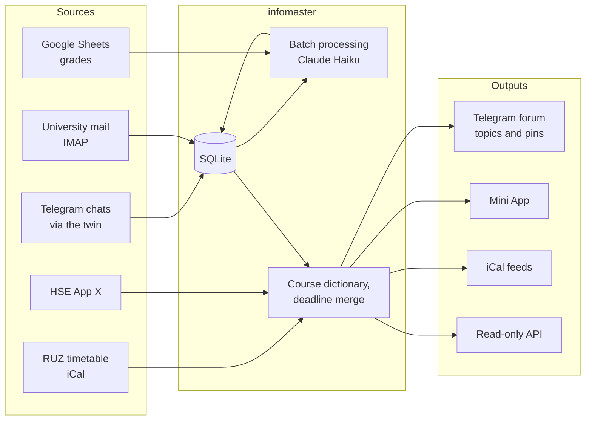

# infomaster

[](https://github.com/IvanIkra/infomaster/actions/workflows/ci.yml)

[](LICENSE)

A self-hosted study assistant for university students. infomaster reads course chats, the university
mailbox and the university's own services, works out what matters with an LLM, and publishes the result to a
Telegram forum, a Telegram Mini App, iCal feeds and a read-only HTTP API.

It was built for HSE University (RUZ timetable, HSE App X, an `@edu.hse.ru` mailbox) and as the data backend of
Tablo, a home dashboard; both integrations are optional.

## Features

- **Telegram reader.** A separate user account (the "twin") reads the chosen chats and channels over MTProto.
  Messages are processed in batches every N hours; in chats marked urgent, soon after a pin, a PDF or a message
  from an important person.
- **News and deadlines from free text.** Claude Haiku turns batches of messages and letters into news items,
  deadlines and events with JSON-schema structured output; a course dictionary keeps course names consistent.
- **One deadline list.** Deadlines from HSE App X, RUZ midterms, mail, chats and the owner's own entries are merged,
  de-duplicated and can be hidden; the same list goes to the forum, the Mini App and the API.
- **Timetable.** Classes from the RUZ iCal feed plus events and class changes found in chats, published as
  `main.ics` (where one has to be) and `optional.ics` (where one may go), ready for Apple or Google Calendar.
- **Problem sheets.** PDFs from chats are downloaded on demand, read within a page limit and versioned; a new
  version edits the old forum message and says what changed.
- **Grades.** Teachers' Google Sheets are read as xlsx; Haiku maps each tab's header once (cached with the header),
  grades are normalised to a 0–10 scale and only new or changed ones are announced.
- **Daily summaries** of chats and the `/summary` command for any chat and period.
- **Images.** Pictures in messages are read by Haiku within a daily count and the budget.
- **LLM budget.** Every call is journaled with its cost; a daily dollar limit with priorities (study chats first,
  then mail, then the rest) and a 30-day spending chart in the Mini App.
- **Two languages.** The forum and the Mini App switch independently between English and Russian.

## How it works



A single asyncio process runs the collectors, the processing pipeline and two HTTP servers:

| Port | Exposed | Serves |
|---|---|---|
| public, `8080` | through Tailscale Funnel | Mini App (Telegram `initData` check, owner only), HSE App X login callback, personal iCal feeds |
| internal, `8081` | Docker network only | `/api/deadlines`, `/api/news`, `/api/grades`, `/api/status` (Bearer token), feeds for Tablo |

The full design is in [docs/architecture.md](docs/architecture.md); the reasoning behind each choice is in
[docs/decisions.md](docs/decisions.md) (decisions are referred to as D1, D2… in the code), and the Tablo logic it
inherited is in [docs/sources-overview.md](docs/sources-overview.md) (referred to as §N).

## Tech stack

Python 3.12 · asyncio · [Telethon](https://github.com/LonamiWebs/Telethon) · aiohttp · SQLite ·
[Anthropic SDK](https://github.com/anthropics/anthropic-sdk-python) · pypdf · openpyxl · icalendar ·
Docker Compose · Tailscale Funnel. The Mini App is plain HTML and JavaScript with no build step.

## Getting started

You need a Telegram bot, a forum group, a spare Telegram account for the twin, an Anthropic API key and a Tailscale
account with Funnel enabled.

```bash
git clone https://github.com/IvanIkra/infomaster.git
cd infomaster
cp .env.example .env    # fill in the values, every variable is commented
docker compose up -d --build
```

Then send `/start` to the bot, open the Mini App and log the twin in under **Settings → Twin and chats**.
The step-by-step guide (bot rights, Tailscale policy, every optional source) is in [docs/setup.md](docs/setup.md).

### Configuration

Secrets live in `.env`; everything else is set in the Mini App.

| Variable | Required | Purpose |
|---|---|---|
| `TG_API_ID`, `TG_API_HASH` | yes | Telegram application from my.telegram.org |
| `TG_BOT_TOKEN` | yes | bot from @BotFather, an admin of the forum |
| `TG_OWNER_ID` | yes | the only Telegram user the bot and the Mini App let in |
| `TG_FORUM_ID` | yes | the forum group, `-100…` |
| `ANTHROPIC_API_KEY` | yes | batch processing, sheets, grades, summaries, images |
| `API_TOKEN` | yes | Bearer token of the internal API |
| `PUBLIC_URL` | yes | Funnel address, `https://infomaster.<tailnet>.ts.net` |
| `TS_AUTHKEY` | first start | auth key for the Tailscale sidecar |
| `CONTAINER_DNS_1`, `CONTAINER_DNS_2` | yes | DNS servers of the containers |
| `RUZ_ICAL_URL` | no | personal RUZ feed |
| `CALENDAR_SECRET`, `CALENDAR_PUBLIC_SECRET` | no | secret path segments of the internal and public iCal feeds |
| `MAIL_USER`, `MAIL_PASSWORD` | no | university mailbox with an app password |

## Development

```bash
python3.12 -m venv .venv && .venv/bin/pip install -e '.[dev]'
.venv/bin/pytest -q
.venv/bin/ruff check .
```

Run locally with `.venv/bin/python -m infomaster --data data`. Other commands: `login` logs the twin in from a
terminal, `import-tablo --tablo-db <tablo.db>` moves own and hidden deadlines from Tablo once.

```
infomaster/
├── collectors/   # Telegram twin, mail, RUZ, HSE App X, files, grade sheets
├── processing/   # batches, deadlines and merge, events, schedule, sheets, grades, summaries, images
├── outputs/      # forum bot and its topics, Mini App, iCal feeds, internal API
├── llm/          # client with structured output, daily budget, journal
├── settings/     # general and per-chat settings
├── store.py      # SQLite
└── app.py        # wiring
tests/            # pytest
docs/             # architecture, decisions, setup guide, notes on Tablo
```

## Status

Stages 1–9 of the plan ([docs/architecture.md](docs/architecture.md), §11) are done and covered by tests: the
twin and chat settings, batch processing, the course dictionary and timetable, deadlines, problem sheets,
summaries, grades and images. The API for Tablo (stage 10) is done on the infomaster side, and the service runs
next to Tablo.

Not yet verified on live Telegram, Haiku and Google Sheets: problem sheets, summaries, grades, images, the
reworked Mini App and the language switch. Text length is checked in characters rather than by the rendered
width of the Inter font.

## License

[MIT](LICENSE)
